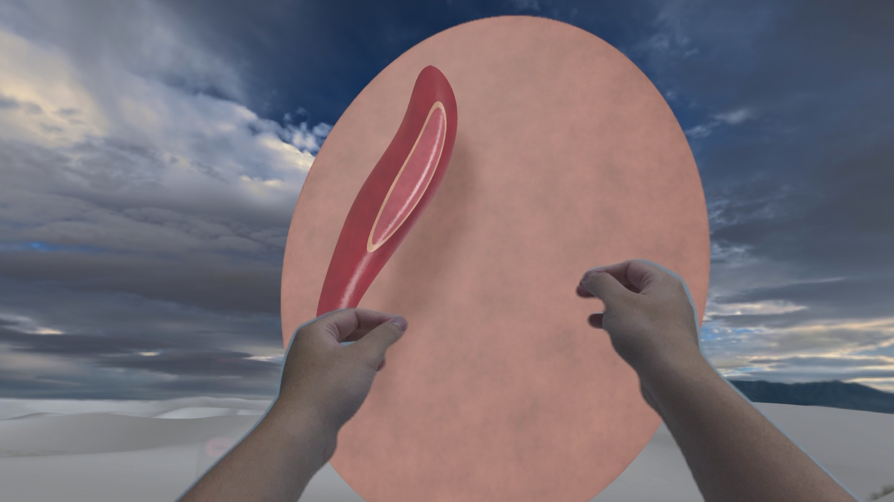
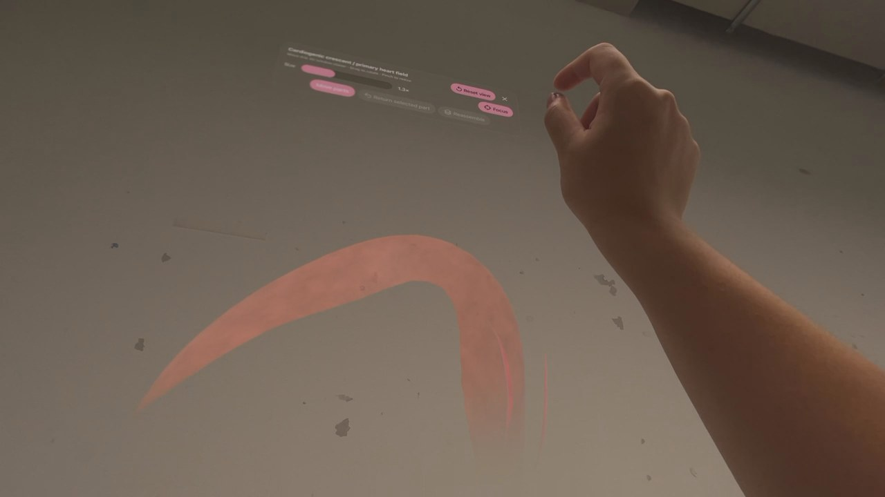
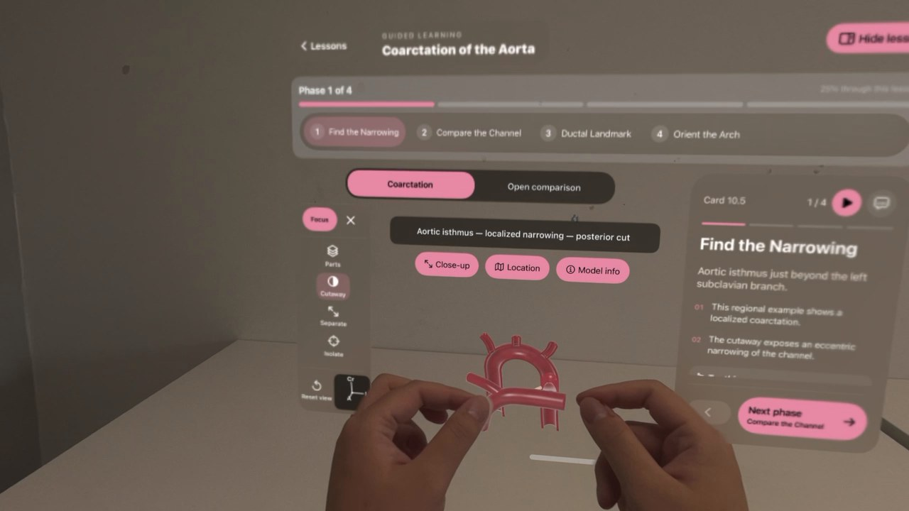
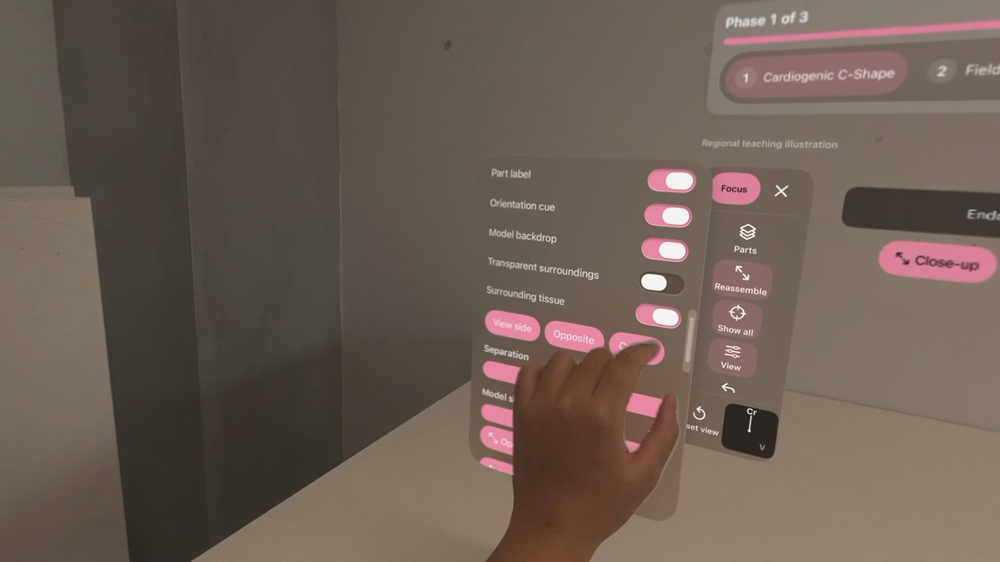
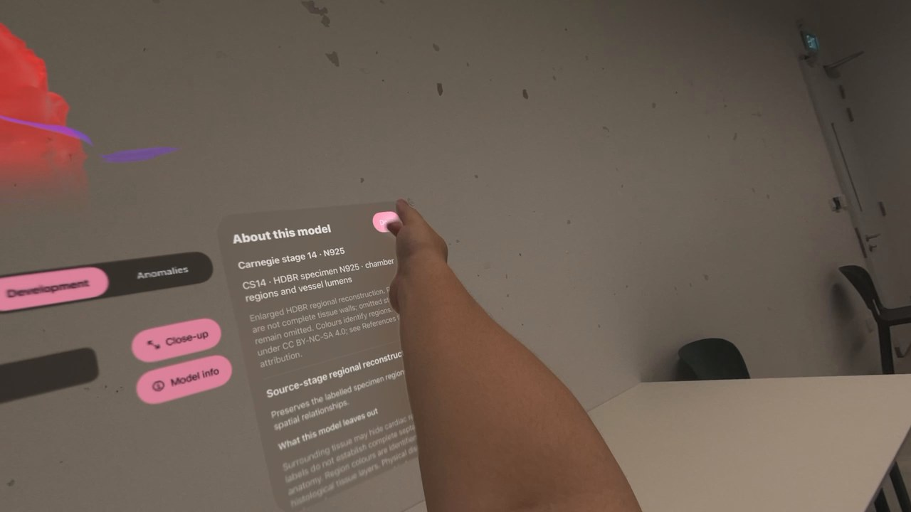

# Visual evidence index

The images are unedited still frames extracted from the user's two app-test recordings. They are **illustrative snapshots**; consult the original video around each time for gesture intent and continuity. Elapsed timestamp = seconds encoded in filename (`A_key_265` = A 04:25).

| Image | Video timestamp | Why it matters |
|---|---:|---|
| `B_key_015.jpg` | B 00:15 | Paired heart tubes baseline, side instructional card, small tool strip |
| `B_key_028.jpg` | B 00:28 | 3D anatomy becomes very large during two-hand manipulation |
| `B_key_052.jpg` | B 00:52 | Primitive heart tube, stage information, source caveat, dense UI |
| `B_key_070.jpg` | B 01:10 | Anatomical geometry near field-of-view boundaries |
| `B_key_074.jpg` | B 01:14 | Oversized geometry persists and obstructs lesson context |
| `B_key_096.jpg` | B 01:36 | Small, distant floating controls high in field of view |
| `B_key_113.jpg` | B 01:53 | Manipulation with anatomy spanning most of the view |
| `B_key_114.jpg` | B 01:54 | Close view of detached geometry elements |
| `B_key_133.jpg` | B 02:13 | Isolated/decomposed model pieces and gesture context |
| `B_key_144.jpg` | B 02:24 | Large structure near user with persistent handling |
| `B_key_155.jpg` | B 02:35 | Continued separated anatomy / reaching |
| `A_key_042.jpg` | A 00:42 | Cardiogenic region phase header, text/action hierarchy |
| `A_key_080.jpg` | A 01:20 | Isolated single structure; reassemble/show all controls |
| `A_key_093.jpg` | A 01:33 | Advanced View controls, many small toggle targets |
| `A_key_176.jpg` | A 02:56 | “Find the Narrowing” gives anatomical finding directly |
| `A_key_182.jpg` | A 03:02 | Detached anatomy below distant floating panel |
| `A_key_197.jpg` | A 03:17 | Aorta actively manipulated at close range |
| `A_key_225.jpg` | A 03:45 | Progress is framed as lessons completed |
| `A_key_238.jpg` | A 03:58 | Control panel above model, separated from context |
| `A_key_246.jpg` | A 04:06 | Context during exploration (model and controls) |
| `A_key_265.jpg` | A 04:25 | Enlarged geometry alongside detached ceiling-level panel |
| `A_key_297.jpg` | A 04:57 | Circulatory transition keys and pre-/post-birth comparison |
| `A_key_325.jpg` | A 05:25 | Fragmentation and enlarged model example |
| `A_key_360.jpg` | A 06:00 | Large Carnegie-stage geometry |
| `A_key_370.jpg` | A 06:10 | Model provenance/limits panel |

## Selected screenshots

### Runaway model scale — B 00:28

### Spatial drift — A 04:25

### Instruction/answer leakage — A 02:56

### Dense settings — A 01:33

### Source caveats — A 06:10

- `A_key_395.jpg` — A 06:35: coloured anatomy visible near welcome panel after navigation, indicating a scene-persistence question requiring code verification.
