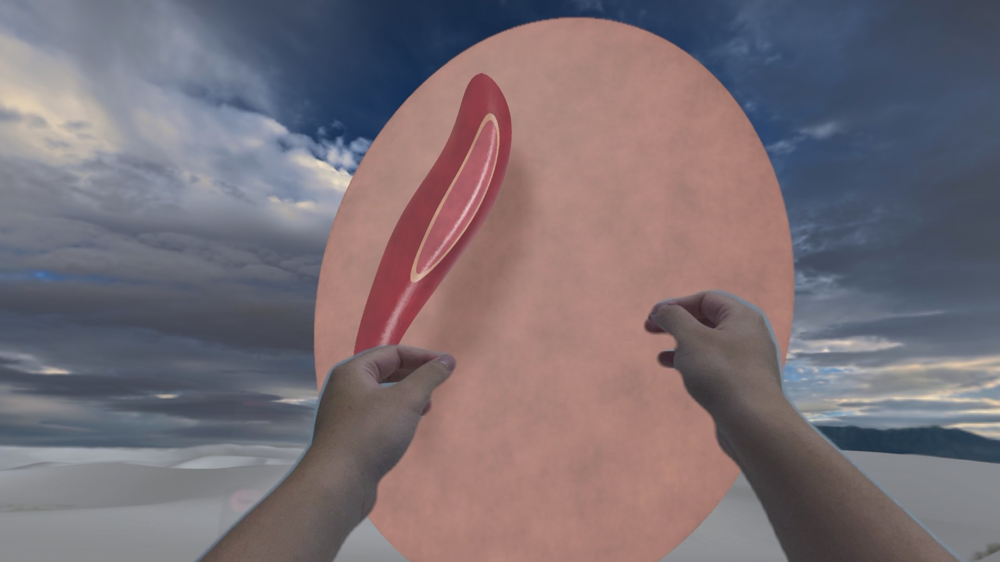
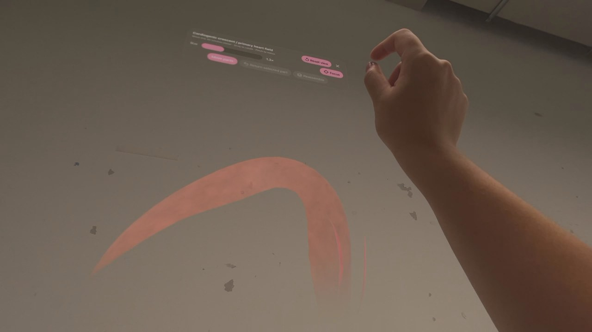
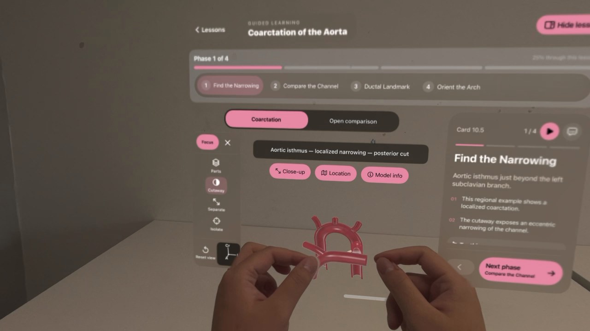
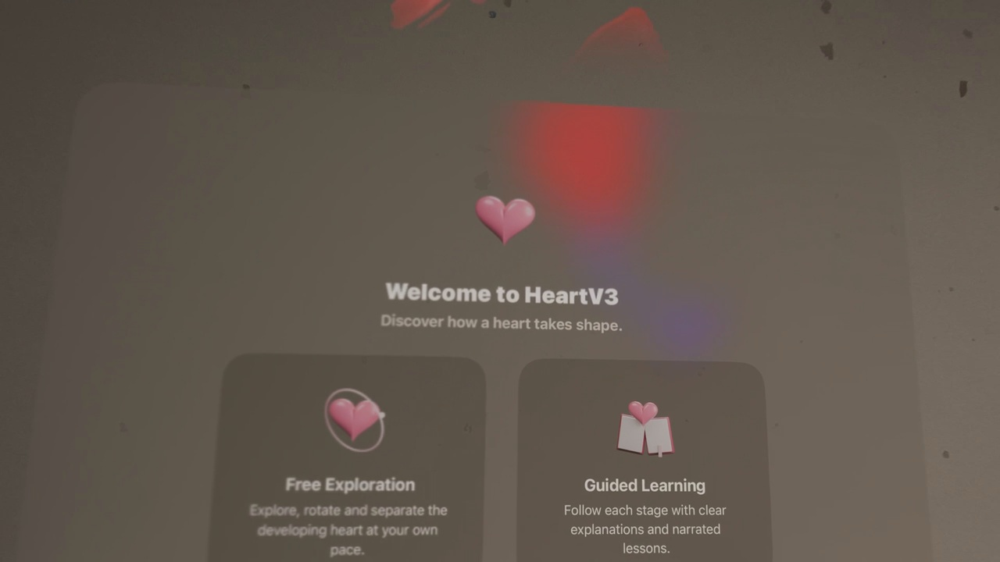

# HeartV3 — second-pass interaction and learning audit

**For:** Codex engineering team and the interaction/medical education design team  
**Reviewed:** 22 October 2026  
**Source recordings:** A = `ScreenRecording_10-22-2026 17-09-36_1.mov` (6m 48s, passthrough), B = `ScreenRecording_10-22-2026 17-18-44_1.MP4` (2m 51s, immersive). All timestamps are **elapsed video timestamps**, not clock time.

**Mission:** *Make embryological development memorable and understandable enough to persist past examinations and into real clinical pattern-recognition.*

## Second-pass verdict: what the experience currently optimises for

The app has a valuable underlying interaction: **directly exploring a changing three-dimensional heart**. But its visible design disproportionately rewards **moving anatomy** and **moving through screens**, not **constructing a correct causal account** of embryological change. Those are not equivalent tasks. An engaging spatial model is only educationally valuable when it makes the right relationship perceptible, helps the learner reason about the mechanism, and later tests that reasoning in a new context.

The recordings demonstrate substantial feature breadth—guided lessons, phase navigation, stage reconstructions, free exploration, isolate/separate/cutaway, anomalies, a normal-vs-abnormal comparator, model provenance and a birth-transition lesson. **Do not remove these capabilities indiscriminately.** The failure is in control over their use, legibility, recoverability and connection to assessable outcomes.

### Key distinction: software failures versus product-design failures

- **Observed interaction failures:** 3D scaling/placement becomes unmanageable; learning controls become remote; models can visually remain in surrounding navigation; meaning and location of separated parts become unclear. These have actual video timecodes and need reproduction in hardware.
- **Strong design concerns demonstrated by the UI:** competing tool verbs, tiny distant spatial text, unstable anatomical orientation cues, dense/transparent cards, answer leakage in “Find the Narrowing”. These are correctable interaction/content problems even when code behaves as programmed.
- **Learning outcomes not proven by these tests:** no direct evidence of learners explaining a mechanism unaided, recognising a defect in an unfamiliar clinical modality, or remembering it weeks later. **This is a measurement/design gap, not proof that the app has zero quizzes or no educational effectiveness.**

## Priority zero: four tasks that change the product's quality

| Order | Core fix | Precise evidence | What acceptance must show |
|---|---|---|---|
| 1 | **Keep anatomy controllable.** Stable model-root scale bounds, reliable pinch tracking, named standard view, persistent Fit/Recentre. | B 00:24–00:36, 01:08–01:16, 01:44–02:35; A 03:00–03:20, 05:20–05:30. | Rapid repeated two-hand scaling never loses a usable whole-model view; one reachable action restores it. |
| 2 | **Keep the workspace coherent.** Learning controls do not drift overhead and stale model content does not appear on menus after leaving scenes. | A 02:40–02:45, 03:40–04:00, 06:30–06:40; B 01:24–01:40. | Lesson dock and model remain jointly accessible; navigating to home/catalogue leaves no visually intrusive model. |
| 3 | **Remove answer leakage and measure actual retrieval.** “Find the Narrowing” must require a response before revealing lesion name/location. | A 02:55–03:00: header and card literally give “Aortic isthmus … beyond the left subclavian branch”. | Blinded localisation attempt → optional hint → corrective reveal; passive viewing never counts as independent mastery. |
| 4 | **Design one complete developmental-to-clinical learning loop.** Use normal mechanism → interrupted development → final structure → unfamiliar clinical finding → later recall. | Development and anomalies are both present, but A 04:40–06:25 does not demonstrate a linked transfer task. | An expert-approved first lesson contains correct prediction, explanation, and unseen clinical transfer tasks, each stored separately. |

### A visual proof set

**B 00:28.** Scale has expanded so far that the recognisable paired-tube model becomes an enormous pink form occupying most of the view. This is an anatomical legibility failure, irrespective of whether the gesture was intentional.

{width=5.3in}

**A 04:25.** The user is manipulating geometry while the task controls float in a remote upper region of the scene. Recovering the model now requires spatial management, not embryology.

{width=5.3in}

**A 02:56.** A lesson titled “Find the Narrowing” explicitly discloses the aortic isthmus location. It tests reading, not spatial identification.

{width=5.3in}

**A 06:35.** Coloured model content is still visible above the welcome interface after lesson navigation; this suggests stale scene content or deliberate persistent content requiring clarification. Instrument the app before attributing a lifecycle defect.

{width=5.3in}

## Red-pen critique: interaction-design principles being violated

### 1. Physical manipulability is being mistaken for conceptual control

The anatomy is graspable, resizable and decomposable, but once it swells or fragments, it ceases to communicate the relationship it was meant to teach. **The user's freedom should be maximised inside a pedagogically meaningful envelope**: bounded moves, clear anatomical axes, part origins, and recovery. Avoid making users solve the VR interface when the learning objective is cardiac development.

### 2. The learner is asked to read and reach simultaneously

The user must repeatedly split attention among model, the stage rail, the active-part caption, the vertical toolbox and the long side card. For a developmental mechanism, a step should ideally show **one anatomical event, one purposeful interaction and one short explanatory statement**. Detailed references should be available but not compete at every instant.

### 3. Chronology, anatomy and explanation are not integrated strongly enough

**Day/Carnegie stage**, lesson **phase**, animation **frame**, card **number**, and navigation **progress** are overlapping concepts. The app risks making the learner remember individual pictures rather than a transformation. The learner needs the same tissue/landmark to remain visibly traceable as the heart folds, fuses, loops or partitions, with a reversible scrub and a prediction before the reveal.

### 4. Recognition tasks are being contaminated by prompts

A finding exercise is invalidated if the interface names the finding immediately. In clinical pattern-recognition, giving the diagnosis, lesion or location away prevents the app from checking **what the learner could recognise independently**. Hints and assisted answers are useful teaching mechanisms, but must be recorded differently from successful first attempts.

### 5. The destination is diagnosis-relevant reasoning, not model familiarity

Knowing a stylised three-dimensional lesion is not sufficient for recognising it in an unfamiliar anatomical orientation, image modality, cross-section or clinical vignette. A mature lesson should ask the learner to: **localise the deviation, describe its normal developmental mechanism, predict an anatomical/functional consequence, and identify a distinguishing clue in an unseen representation**. All medically substantive scenarios, imaging and mechanism claims require subject-matter review.

### 6. “Completed” is an ambiguous metric

The app visibly reports lessons completed (A 03:45) while buttons invite simple progression. Completion is evidence of navigation; it is not evidence of durable retention. Separate at least **viewed**, **attempted**, **correct unaided**, **correct with hint**, **explained**, **transferred**, and **retrieved after delay**.

## Proposed reference interaction — apply to exactly one vertical slice first

For **Coarctation of the Aorta / Find the Narrowing**, first present the unlabelled arch in a named view. Pose “Which segment has an abnormal calibre?” without the lesion location. Let the learner select the region. On a miss, give graduated hints that preserve a second attempt; then reveal the location, show a matched normal view at the same scale, and explain the comparison. Finally present an **unseen, educator-approved** depiction (e.g. a different anatomical projection or appropriately selected clinical representation), asking for the location and differentiating clue. Revisit after a delay with a parallel task. This is the template to reuse across developmental defects once validated.

**Release measure:** usability in a real headset **plus** immediate unseen transfer **plus** delayed recognition and explanation. Until measured, describe the product as *aiming* for long-term clinical pattern-recognition, not as proven to deliver it.

---

## Detailed issue register — observed interaction and usability risks

Each ticket includes evidence, expected behaviour, a suggested fix and an acceptance condition. The implementation approach is a recommendation; verify the actual spatial rendering / gesture stack first.

### HV3-001 — 3D objects grow far beyond a usable scale [P0, Observed]

**Evidence:** B 00:24–00:36, 01:08–01:16, 01:44–02:35; A 03:00–03:20, 04:20–04:30, 05:20–05:30, 06:00–06:10. Oversized surfaces fill much or nearly all of the view and obscure anatomy, spatial context or the lesson. Screenshot `evidence/B_key_028.jpg` and `evidence/A_key_265.jpg`.

**Reproduce:** Open Paired heart tubes in guided mode; use two-handed model manipulation and change hand separation; repeat after entering free exploration or isolating a structure. **Expected:** proportional, bounded scale with the anatomical unit continuously legible. **Actual visible:** tissue expands to room-scale or larger and loses recognisable shape.

**Fix:** Put a safe scale envelope around *each model root*, not per-mesh scaling; clamp pinch deltas and smooth tracking drop-outs; preserve a model-relative pivot and world-size constraints. Provide a predictable **Fit model** action adjacent to the object and in the persistent toolbar. Prevent a large selection plane from being mistaken for the model's true scale.

**Accept when:** normal two-handed gestures cannot exceed a defined comfortable envelope, geometry never fills the whole view unintentionally, and a single visible action restores a coherent full-model view within two seconds. Test normal and detached meshes, near/far placement and both recordings' environments.

### HV3-002 — Model and controls separate spatially [P0, Observed]

**Evidence:** B 00:24–00:44, 01:24–01:40, 02:36–02:40; A 03:10–03:25, 03:50–04:05, 04:20–04:30. Users look sharply up towards miniaturised/far-away controls while enlarged structures remain below or behind. `evidence/A_key_238.jpg`, `evidence/B_key_133.jpg`.

**Reproduce:** Move/scale a model repeatedly while its lesson controls are open. **Expected:** the controls and learning object remain accessible as one task unit. **Visible:** model takes up a different part of the world; essential controls are distant or above eye level.

**Fix:** Separate a reliable user-reachable *HUD/control dock* from the manipulative model anchor; implement “Bring model to me / Recentre workspace”, safe-distance bounds, and a focus action that brings the object beside the relevant explanation. Do not attach the entire lesson panel to a geometry root that learners can move.

**Accept when:** controls remain visible and comfortably selectable after rotation, scaling, isolation, recentring, environment changes and advancing a lesson; no routine step requires looking up at the ceiling to recover a panel.

### HV3-003 — Separated pieces lose an understandable whole [P1, Observed; intention uncertain]

**Evidence:** A 01:00–01:20, 03:00–03:10, 05:05–05:30; B 01:48–02:20. A number of pieces visually detach or are isolated far from the organ. The toolbar includes **Separate / Reassemble**, so separation is in part deliberate. The issue is discoverable and recoverable *anatomical relationships*, not separation itself.

**Fix:** A constrained explode mode with named parts, retained axis and translucent original-position ghosts; bounded explosion distance; one-step **Reassemble all**; per-part drag should show origin and snap-back. Make it unmistakable which parts are hidden vs exploded vs individually grabbed.

**Accept when:** testers can state where a selected part belonged and restore all pieces with one action; transitions do not leave orphan geometry after mode switch.

### HV3-004 — Reset/focus/reassemble controls overlap conceptually [P1, Observed]

**Evidence:** A 01:30–01:40 (View settings), A 02:00–02:25 (**Focus**, **Show all**, **Reassemble**, **Reset view**); B 00:48–01:04 (**Focus**, **Separate**, **Isolate**, **Reset view**). The available verbs differ according to mode without exposing what state each will reset.

**Fix:** Formalise independent state axes: camera pose, model transform/scale, part visibility, exploded state, selection, current developmental time. Define a deliberate top-level **Reset model** that restores all five visual axes without discarding lesson progress. Retain granular **Fit**, **Show all**, **Reassemble**, **Reset orientation** as secondary actions with clear descriptions.

**Accept when:** identical operations produce predictable effects across lesson/free/anomaly modes; automated state tests cover all reset combinations, and user-facing labels describe what will change.

### HV3-005 — Interaction intent is difficult to read from feedback [P1, Observed; Verify selection logic]

**Evidence:** B 01:45–02:34 includes repeated reaching, pinching and placing hands on anatomy without an obvious persistent indication of what is selected or which interaction is active; A 01:00–01:20 similarly changes the viewed parts. The recording alone cannot prove taps were missed.

**Fix:** Strong hover target, selected-part outline (not colour alone), gentle depth cue, short label, and distinct feedback for grab / rotate / resize / isolate. Add gesture-help microcopy on first use. Delay destructive/large transforms until grab confidence is high.

**Accept when:** observers can tell from the recording which part is selected and what gesture is active; attempts to select closely spaced parts yield deterministic results.

### HV3-006 — World-space interaction conflicts with ordinary task posture [P1, Observed]

**Evidence:** B 01:24–01:40 and 02:36–02:40, A 03:00–03:20 and 03:45–04:05; controls require arm extension or are placed high above eye level.

**Fix:** Put the primary dock in the ergonomic interaction zone; use head-facing or user-repositionable panels, with a subtle recenter gesture/action. Make small labels readable at typical working distance. Avoid repeated high reaches and prolonged two-hand hold positions.

**Accept when:** 95% of observed routine tasks are performed without repeated overhead reaching; panel targets remain selectable in both passthrough and immersive spaces. Instrument reach time and recenter usage.

### HV3-007 — Mode switches may preserve visually disruptive state [P1, Observed; Verify lifecycle]

**Evidence:** A 03:40–03:55 shows large aortic remnants around/above the guided catalogue and subsequent free exploration; A 06:30–06:40 returns to welcome while oversized red/purple content remains visually near the scene. The recordings do not prove an actual resource leak.

**Fix:** Explicit model-scene ownership and cleanup on navigation; a single active pedagogical model per workspace unless intentionally comparing two. Reset/park geometry on lesson close, mode switch and home; dispose subscriptions/animations/gesture state and preserve only intentional progress.

**Accept when:** home and catalogue are visually free of stale models; reopening a different lesson does not inherit the previous model's scale/translation or selection; memory/object-count checks show no accumulating duplicate entities.

### HV3-008 — Panels compete with anatomy rather than annotate it [P1, Observed]

**Evidence:** A 00:40–00:55, 02:55–03:30, 04:40–05:10; B 00:15–00:22, 00:48–01:04. Explanatory sentences are in a detached side card; a selected part is indicated by a separate black caption bar, without a persistent leader or a shared spatial reference.

**Fix:** Context-sensitive annotation anchored to anatomy with leader lines, one primary relationship visible at a time, and a docked **What changed / Why it matters** overlay. Move the educational callout with the part only within safe bounds; provide an always-visible back-to-context control.

**Accept when:** learners can identify the explained structure without reading an external label and guessing which mesh it references; annotation remains legible during manipulation.

### HV3-009 — Text and targets are too small for spatial reading [P1, Observed]

**Evidence:** A 00:25–00:40, 01:25–01:40, 05:55–06:10; B 00:48–01:04. Dense steps, tiny settings toggles and small toolbar icons compete with large empty space. `evidence/A_key_093.jpg` and `evidence/B_key_052.jpg`.

**Fix:** Spatial typography scale based on **visual angle** at expected reading distance, not just point size. Enlarge critical controls, separate target hit areas, shorten text into steps, and make detail panels adjustable without resizing anatomy. Support a large-text option; test at actual headset resolution.

**Accept when:** the smallest instructional body text is comfortable to read at normal placement, all action targets have sufficiently large effective hit regions with spacing, and enlarged text does not clip/overlap.

### HV3-010 — Transparency and background reduce legibility [P1, Observed]

**Evidence:** B 00:15–01:04: translucent grey panels over sky/sand. A 00:40–01:25: grey-on-grey text over a lightly textured wall. Pink active states are clear, but many passive labels have weak contrast.

**Fix:** Add a real readable material/backplate to copy-bearing panels; dynamic or stronger contrast when background luminance changes, distinct disabled vs available states, and avoid information encoded solely by pink. Test on dark sky, bright sky, textured walls and mixed passthrough lighting.

**Accept when:** audited text/control contrast meets applicable WCAG-equivalent targets *where measurable* and real-headset testers can read body text in both video settings without leaning forward.

### HV3-011 — No stable visible orientation map for anatomy [P1, Observed]

**Evidence:** A 00:40–02:40 and B 00:15–01:04 include small orientation glyphs but no obvious persistent cranial/caudal, left/right or anterior/posterior context anchored to the currently manipulated specimen. Rotations make location difficult to reconstruct.

**Fix:** Anatomical orientation widget coupled to model rotation, optional axes/planes and **Return to anatomical view** presets (anterior, posterior, transverse/sagittal when applicable). Differentiate specimen orientation from camera orientation.

**Accept when:** a learner can identify left/right and cranial/caudal after arbitrary rotation, and return to a named standard view in one selection.

### HV3-012 — Parts, Cutaway, Separate, Isolate and View lack hierarchy [P2, Observed]

**Evidence:** A 00:45–01:35 and 03:15; B 00:48–01:04. The tool palette sometimes shows a dynamically changing combination of **Parts**, **Cutaway**, **Separate**, **Isolate**, **Rotate**, **View**, **Focus**.

**Fix:** Organise into three families: **Inspect** (select/highlight/isolate), **Transform** (rotate/scale/fit), **Reveal** (cutaway/explode/opacity). Show only the pertinent 2–3 controls by default, with an explicit **More tools** panel. Keep vocabulary and placement stable.

**Accept when:** a first-time learner can find “show only this vessel”, “put everything back”, and “show a cutaway” with no guessing between near-synonyms.

### HV3-013 — Dense “View controls” panel exposes implementation complexity [P2, Observed]

**Evidence:** A 01:25–01:40 shows Part label, Orientation cue, Model backdrop, Transparent surroundings, Surrounding tissue, view directions, Separation and model-scale controls in a long floating panel (`evidence/A_key_093.jpg`).

**Fix:** Default presets (**Learn**, **Explore**, **Clinical comparison**) plus progressive disclosure for advanced visual controls. Persist reasonable preferences but reset unsafe combinations per model. Use immediate preview and undo.

**Accept when:** routine lesson tasks never require opening the advanced panel; options have observable effect, intelligible labels and recoverable defaults.

### HV3-014 — Animation progression is hard to distinguish from lesson progression [P2, Observed]

**Evidence:** A 00:40, 01:45–02:35 and B 00:48–01:04. A small play/stop icon and `1/3` occur beside a **Phase 1 of 3** progress row, with day labels and separate **Next phase** buttons. The relationship between clip, phase and developmental time is not self-evident.

**Fix:** Split **Play this transformation** (with reversible scrub, pause, replay and speed) from **Continue to next concept**. Explicitly display **Stage 1/3: paired tubes fuse** and **Day / Carnegie stage** where relevant. Never let playback and phase state silently diverge.

**Accept when:** a user can say what is animated, what constitutes the next phase, and whether the model is paused, progressing or complete.

### HV3-015 — Back, Home, Lessons and Hide lesson may be confused [P2, Observed]

**Evidence:** A 00:25–00:40, 02:45–03:00, 03:45–04:05; B 00:15, 00:44. Navigation appears in different positions based on context.

**Fix:** Keep a simple breadcrumb (`Home / Guided Learning / Lesson / Phase`), make **Hide lesson** act only on instruction panels (not model state), and label navigation that discards or saves a current state. Include an obvious return to lesson after free explore.

**Accept when:** users can reliably return to the previous lesson or catalogue without accidental loss of model state or unexpected mode changes.

### HV3-016 — Large immersive background can hinder object visibility [P2, Observed]

**Evidence:** B 00:15–01:16; sky, horizon and white sand form a rich but distractive backdrop. In A, wall texture can show through translucent geometry (`evidence/B_key_015.jpg`).

**Fix:** Offer an anatomy-first neutral workspace/backdrop, optional environment dimming and depth/shadow cues; keep an immersive environment as an opt-in setting. Ensure anatomy is visible for all colour/opacity combinations.

**Accept when:** the same labels, models and selection states remain recognisable in passthrough, immersive landscape and neutral high-contrast mode.

### HV3-017 — System launcher appears during hands-on testing [P2, Verify; not a crash claim]

**Evidence:** B 01:20 and 02:44–02:48 shows system-level app icons; B 01:32 shows “Lock in Place / Close … / Hide Other Apps” controls. Could be intentional tester actions, OS gesture interception, window placement behaviour or an app exit.

**Fix:** Reproduce in a controlled session: record gesture sequence, app lifecycle transitions and system-gesture conflicts. Where preventable, avoid placing key gestures in conflict with system gestures. Restore a safe model state on return to the app.

**Accept when:** accidental leave/return cannot strand the model in an unusable state. Do **not** label as app crash without diagnostics.

### HV3-018 — References/provenance have weak in-context discoverability [P2, Observed; Verify other access]

**Evidence:** A 00:05–00:20 and B 00:04–00:08 show a References screen reached from welcome. A 06:10–06:15 shows specimen/model provenance details. The footage does not establish whether every lesson has an easily discoverable reference link.

**Fix:** In each model and anomaly card, provide accessible **Source and limits** linking directly to provenance, schematic caveats, licence/attribution and latest review date. Keep reference access available within the lesson, not only at onboarding.

**Accept when:** a learner can open the provenance for the specific displayed model in two actions, and return to the same learning state.

### HV3-019 — Clinical-content panels can obscure the model and each other [P2, Observed]

**Evidence:** A 06:05–06:15 shows a source/model-information panel adjacent to large anatomy and near the edge of the view (`evidence/A_key_370.jpg`). A 05:00–05:10 shows free-exploration callouts beside scattered structures.

**Fix:** Limit secondary panels, enforce collision/occlusion margins, stack drawers within a persistent safe zone and introduce **Pin / Close** affordances. Never open a new sheet outside easy reach.

**Accept when:** modal details do not overlap the active anatomical target or fall outside the normal field of view at default placement.

### HV3-020 — Small or ambiguous tool icons have inadequate affordance [P2, Observed]

**Evidence:** A 00:45–01:35, B 00:48–01:04. Icons for stateful isolate, rotate, view and reset are visually similar in a narrow vertical column, with several text labels small or partially obscured.

**Fix:** Use icon + persistent short label + pressed state; explicit tooltips with gesture hints; generous targeting and separation. Prefer verb-object labels (e.g., **Isolate selected structure**).

**Accept when:** a novice can identify the current active tool without relying on colour or remembering its last action.

### HV3-021 — Structural highlighting does not consistently explain shape/identity [P2, Observed]

**Evidence:** A 01:10–01:20 and 02:20–02:35 show a single peach/pink oval remaining after isolation, without robust relation to nearby heart-field context. B 01:00–01:04 shows similarly isolated tube forms.

**Fix:** Pair isolate mode with a mini context silhouette, label, ghost of the whole and a clear **Show in context** action. Display the selected developmental stage consistently.

**Accept when:** isolated parts can always be related back to their parent anatomy, anatomical axes and current timepoint.

### HV3-022 — Model manipulation lacks a visible safe “undo” [P2, Verify]

**Evidence:** Repeated transformations in A 03:00–04:30 and B 01:45–02:35 have no unmistakable per-action **Undo** beside the model; there is a **Reset view** in some states. This is not proof undo is absent elsewhere.

**Fix:** Add local one-step **Undo last manipulation** and a distinct **Restore default view**. Preserve learning progress. Keep Undo available even after a failed grab and accidental explode.

**Accept when:** after three independent transforms, users can reverse the last transform without reversing the lesson or losing selections; reset always recovers.

## 3. Issue register — instructional design and clinical pattern-recognition

These are **product-design changes**, not necessarily application errors. They should be prioritised because they directly determine whether HeartV3 meets its stated purpose.

### HV3-023 — Questions sometimes disclose the answer before the learner responds [P0 learning, Observed]

**Evidence:** A 02:55–03:30, **Coarctation of the Aorta → Find the Narrowing**. The visible description immediately identifies “Aortic isthmus just beyond the left subclavian branch” and explains the narrowing. The model has a specific lesion, but the step is framed as a finding task while the answer is displayed. `evidence/A_key_176.jpg`.

**Fix:** Change to **Predict/Locate → Commit → Reveal/Explain**. Start with unlabelled anatomy; require a learner to locate the narrowing or select the correct branch relation; then show anatomical highlights, explanation and corrective feedback. Preserve a **Show hint** path, with mastery recorded separately from revealed answers.

**Accept when:** a learner cannot complete the first recognition step merely by reading the answer displayed next to it; wrong and right selections receive anatomical rationale, not just green/red feedback.

### HV3-024 — Completion is not visibly contingent on understanding [P0 learning, Design gap]

**Evidence:** A 00:40–02:40 and B 00:15–01:04: **Next phase** remains salient at each explanation. A 03:45 shows **1 of 16 lessons completed**. The recordings show navigation/progress, but not an explicit challenge gate, learner explanation or scored retrieval. A lack of evidence is not proof that no assessment exists elsewhere.

**Fix:** Separate **explored**, **understood in-session**, and **retrieved later**. Add one low-friction knowledge check per mechanism with optional skip that does not count as mastery. Continue should not silently equal learned. Store independent assessment events and confidence.

**Accept when:** progress UI distinguishes viewing from correct independent retrieval; revisiting can improve mastery without corrupting exploration progress; a learner who clicks through every phase has not automatically “mastered” it.

### HV3-025 — The causal bridge from developmental mechanism to congenital defect is underdeveloped [P0 learning, Design gap]

**Evidence:** A 05:40–06:25 jumps among Carnegie-stage reconstruction and anomaly examples (**VSD**, **ASD**); A 04:40–05:35 covers circulatory transition; B 00:15–01:04 covers early tube development. The app contains both developmental and anomaly content, but the footage does not demonstrate a mandatory **normal process → perturbation → altered anatomy → clinical recognition** sequence.

**Fix:** For each clinically relevant developmental event, build a mechanism-linked anomaly module: stage of normal development; a specific failed/altered step; final morphological result; clinically recognisable finding(s); and one unfamiliar presentation. Each example should connect back to the exact moment on the developmental timeline. Content must be reviewed by a qualified embryology/clinical educator.

**Accept when:** from an anomaly, users can navigate directly to its causal developmental event and back; every critical defect has an explicit mechanism and an assessed recognition task.

### HV3-026 — Recognition remains largely dependent on the same stylised 3D representation [P1 learning, Design gap]

**Evidence:** A 06:15–06:25 shows VSD and ASD as 3D anatomical models; the reviewed learning examples mainly use similarly styled reconstructions. There is no visible transfer test using an unfamiliar projection or a clinical representation.

**Fix:** Add **representation transfer**: compare schematic to an appropriately licensed and clinically validated echo/ultrasound/diagram/cross-section/CTA or an appropriately constructed vignette. Ask learners to identify the same defect using a different viewpoint with misleading superficial cues reduced.

**Accept when:** assessment includes at least one **unseen** representation per target defect, and the learner must justify the structural clue and mechanism. Expert-validate images and labels.

### HV3-027 — Development over time is shown as snapshots rather than a tested causal sequence [P1 learning, Observed + Design gap]

**Evidence:** A 00:40–02:40 shows Cardiogenic C-Shape → Field Signals → Pre-Vascular Cords; B 00:15–00:45 shows Lateral Folding and later modules. Phase tabs and playback exist, yet the visible flow emphasises descriptive stages rather than prediction of the next state.

**Fix:** Add a **What changes next?** prompt before a transformation; tween/animate between anatomically validated states with persistent correspondence of structures; let learner scrub backward and replay; then ask **Which movement/process caused this?** Use motion arrows, not merely replacement of models.

**Accept when:** a learner can replay a transformation, name the before/after structures and select its causal process without reading the answer.

### HV3-028 — Exploration is not visibly structured around a learning action [P1 learning, Observed]

**Evidence:** A 03:45–04:35 and B 01:45–02:35 show prolonged manipulation and enlargement without a visible outcome cue or goal. Exploration is legitimate, but the interface rarely tells the learner *what observation to extract* from it.

**Fix:** Offer small optional investigation cards, e.g., “Find where the paired tubes meet”; “Rotate until both inflow and outflow can be identified”; “Isolate and compare the narrowing”. Provide **What did you notice?** prompts and feedback. Leave genuinely free exploration available, with a clear exit.

**Accept when:** at least one purposeful 3D action per module has a defined question, a detectable user response and explanatory feedback.

### HV3-029 — Clinical comparison lacks a consistently locked matched view [P1 learning, Design gap]

**Evidence:** A 03:20–03:35 uses **Coarctation / Open comparison** tabs; A 04:40–05:35 **Before birth / After birth – transitioning**. The concept is strong, but the recording does not show consistently anchored, matched orientation, scale or an explicit highlighted difference.

**Fix:** A/B comparison with synchronised camera and scaling, highlight difference on demand, morph/overlay and an explanation of what the differing structure predicts functionally. Ensure users can independently rotate while optionally keeping views linked.

**Accept when:** switching or comparing states keeps orientation and model scale aligned; one click reveals which anatomical feature differs and why that matters.

### HV3-030 — Part labels and colour do not encode enough meaning [P1 learning, Observed]

**Evidence:** A 04:40–05:15 displays colour-coded foramen ovale, ductus arteriosus, lungs and aorta; some panels explain the colour key in small text. B 00:52 shows pink structural layers. Colour is doing substantial identification work while transformations can disperse parts.

**Fix:** Persistent optional legend with names + shapes/patterns, directional flow arrows, stage-specific anatomical landmarks and structural roles (inflow/outflow, septum, vessel, tissue) that do not rely solely on hue. For source reconstructions, distinguish directly reconstructed anatomy from schematic/inferred connections.

**Accept when:** the core anatomical identification task remains possible in greyscale and with labels off/on; a blind visual test distinguishes key parts by geometry/position/patterns.

### HV3-031 — Feedback does not visibly diagnose misconceptions [P1 learning, Design gap]

**Evidence:** A 01:45–01:55 and 02:20–02:35 show a **Try this** instruction block; no observable moment demonstrates feedback that distinguishes a wrong anatomical choice from a correct one. The recording may simply not test it.

**Fix:** Add misconception-aware feedback: “You selected the ductus arteriosus; the aortic isthmus is just distal to the left subclavian artery,” plus a briefly animated comparison. Provide specific hints before revealing the answer, confidence prompt after the attempt, and a later retry.

**Accept when:** each key challenge has correctness rules, two or more meaningful wrong-answer responses and a retry that does not leak the solution immediately.

### HV3-032 — Progress is presented as completion, not durable retention [P1 learning, Design gap]

**Evidence:** A 03:45–03:50 shows **1 of 16 lessons completed**; other sequences use phase-completion bars. No delayed retrieval, confidence calibration or long-term revisit state appears in these recordings.

**Fix:** A lightweight spaced review queue: same day, next day and later intervals configurable by educator/user; interleave previously learned embryological stages and anomaly recognition; revisit failed/low-confidence items more often. Show **Ready to review** separately from lesson count.

**Accept when:** correct later retrieval influences a distinct retention metric; previously completed content can be practised without rewatching all stages. Review schedule is optional and non-punitive.

### HV3-033 — Dense reading competes with hands-on spatial reasoning [P2 learning, Observed]

**Evidence:** A 00:40–02:35, B 00:15–01:04. The right-side panel often has title, paragraph, multiple numbered statements, controls and navigation at once.

**Fix:** Progressive instruction: **one principle**, **one visible anatomical change**, **one action**. Keep “More detail / References” optional. Time explanations to animation pauses, not while the learner is moving anatomy. Provide captions and optional spoken explanation only if validated and accessible.

**Accept when:** first-view lesson panels typically stay within ~50–75 readable words per step; full scientific explanation remains available without requiring memorisation of a long side card.

### HV3-034 — Developmental source fidelity must be explicit at every representation shift [P1 learning, Observed + Verification]

**Evidence:** B 00:52 explicitly describes an **unfolded map ... not a single embryo snapshot** (a valuable qualification); A 06:10–06:15 model information distinguishes regional reconstruction from complete tissue. These caveats are important but relegated to text/info views.

**Fix:** Persistent model-class badge (**schematic**, **source-derived reconstruction**, **clinical depiction**) and an explainer for what is known, inferred, omitted or stylised. This is especially important when a diagram flows into a complex 3D specimen. Do not visually imply patient-level or specimen-level fidelity without evidence.

**Accept when:** model type and limitations are available at the moment of viewing (not hidden only behind an info panel), and all content references map to each asset.

## 4. Proposed lesson interaction: from anatomy to diagnostic recognition

### A. Before the learner sees the answer — **Orient and predict**

Start with the full structure at a clinically and embryologically intelligible orientation. Say only what is being examined: **“These two endocardial tubes are approaching the midline. What must happen next?”** The learner chooses an expected movement or points to the relevant anatomical region. Provide an optional hint without disclosing the mechanism.

### B. During the change — **Observe a controlled transformation**

Show a bounded animation that links the *same* named anatomy across time. Make each spatial change perceptible using motion arrows, ghosted before-state, labels that track the correct structure and a reversible scrub. Keep controls beside the anatomy, not in a remote floating cluster.

### C. After the change — **Explain, do not just recognise**

Ask for a brief explanation: pick the cause from plausible mechanistic alternatives, order 2–3 events, or mark the area that changed. On error, show why an alternative is wrong. This should be assessed separately from merely visiting the screen.

### D. Introduce the failure — **Predict the consequence**

At the exact developmental step, present a selected perturbation. Ask which adult structure or flow route is likely to be affected. Reveal a normal/anomaly comparison at matched scale and orientation, with clinically verified causal explanation. Avoid presenting all congenital defects as a single simplistic one-to-one causal chain if embryology is more complex.

### E. Transfer — **Recognise the pattern in a new medium**

Present a new, unseen clinical depiction or vignette. Ask learners to identify the structural sign, localise it and connect it to embryological origin. For coarctation, for example, test localisation relative to arch branches first, then compare normal versus narrowed aortic isthmus and (where medically validated) the implications for blood flow. Avoid giving away the diagnosis in the question stem.

### F. Retain — **Retrieve after a delay**

Revisit the structural relationship using a different view and slightly different wording. Prefer 1–3 short retrieval tasks to passive replay of the entire lesson. Store whether an answer was independent, hinted or revealed.

**Core loop:** Orient → Predict → Manipulate/Observe → Explain → Apply → Revisit. It should be possible to play with anatomy without completing this loop, but the system must not conflate *explored* with *understood*.

## 5. Cross-cutting implementation guidelines for Codex

### State and transforms

1. Establish an explicit model root transform separate from selection visuals, cutaway/opacity, explosion offsets and animation track. Never accumulate arbitrary scale multipliers on child anatomical meshes across gestures.
2. Keep `modelTransform`, `activePartIds`, `hiddenPartIds`, `explosionProgress`, `orientationPreset`, `developmentalStage`, `playbackState`, `lessonPhase` and `learningProgress` independently serialisable/testable. Names are **suggested semantics**, not presumed code identifiers.
3. Guarantee a deterministic, idempotent `restoreDefaultModelView()` and a narrower `fitVisibleAnatomy()`; restoring the view must not mark lessons complete or restart the whole app.
4. Put model size, distance and centre-of-view limits in one well-tested configuration; select bounds based on physical scale/field of view and not hard-coded values from the capture resolution. Recalculate after immersive/passthrough transitions and recenter events.
5. Explicitly tear down prior 3D entities, subscriptions, playback and gesture capture on scene changes. Persist assessment state only through the application's intended model, not through lingering visual nodes.
6. Detect hand-tracking confidence loss and abort/smooth runaway transforms; distinguish a user-intended two-hand scale from a two-hand rotate or navigation gesture.

### UI system

1. Build a stable **WorkspaceRoot** with a reachable control dock, independent model anchor, optional education panel and safe-area manager.
2. Use progressive disclosure for tools and information. A single primary action per educational beat; tools like cutaway/explode can remain under Inspect/Reveal.
3. Provide accessible font sizes, large gaze/pinch targets, contrast-safe backgrounds, labelled icon states and non-colour signals. Verify in headset, not only in rendered screenshots.
4. Normalise labels and state mappings across Guided Learning, Free Exploration, Stage Reconstructions and Anomalies; ensure layout scales safely in room and immersive settings.
5. Add event-level telemetry without personal information: `model_fitted`, `model_scale_clamped`, `reset_used`, `tool_misgrab`, `phase_started`, `challenge_answered`, `hint_used`, `model_info_opened`, `session_exited`.

### Learning-content system

1. Represent each step as typed content: **learningObjective → anatomicalState → learnerPrompt → validResponse → feedback → explanation → clinicalLink → source**.
2. Keep **reveal** and **hint** separate from **independent correct answer** in progress tracking.
3. Include a metadata requirement for educational claims and 3D assets: source, model kind, anatomical limits, clinician/educator approval status and update date.
4. Do not automatically generate medical explanations or infer diagnostic findings solely from colour-coded meshes. Clinical educators must approve new content, labels and lesion-mechanism mappings.
5. Build learner assessment as a reusable component before authoring many individual challenge screens; prefer a small set of excellent validated items to a large set of passive cards.

## 6. Fix order / practical pull-request sequence

| Sprint / PR | Scope | Issue IDs | Definition of done |
|---|---|---|---|
| **PR 1 — Stop runaway geometry** | Clamped manipulation, whole-model pivot, safe fit, recenter, tracking-loss handling | 001, 002, 005, 006 | No runaway scale or stranded control dock in both environments |
| **PR 2 — Deterministic restoration** | Separate state axes, unified reset and scene lifecycle cleanup | 003, 004, 007, 022 | One-click recoverability; no stale model after navigation |
| **PR 3 — Readable spatial workspace** | Dock, labels, contrast, targets, tool hierarchy, orientation | 008–016, 019–021 | Novice can select/find/restore and read without leaning or searching |
| **PR 4 — Honest learning progress** | Independent exploration/comprehension state, challenge engine, feedback | 023, 024, 028, 031, 032 | Clicking Next cannot confer mastery; answers/hints are recorded |
| **PR 5 — Developmental causality** | Predictive animation, anatomical continuity, captions and source-class badge | 027, 030, 033, 034 | Learner can predict and explain before/after transformation |
| **PR 6 — Clinical transfer** | Causal defect links, matched normal/anomaly comparison, new-format recognition | 025, 026, 029 | Medically approved application task on an unseen representation |
| **PR 7 — Retention validation** | Delayed retrieval, outcome analytics, headset usability test | 032 + regression | Delayed-recognition results, not just session completion, are measurable |

**Dependencies:** Do PR 1–2 before extensive lesson polish. Do not change model maths and animation content in one unreviewable PR. Clinical content must pass subject-matter review before release.

## 7. Test plan and acceptance checklist

### Spatial-functional regression (real headset)

- [ ] Open Guided Learning → Paired heart tubes → manipulate with one and two hands; repeated resizing cannot lose the full model.
- [ ] Repeated pinch-start / tracking loss / pinch-end / rapid hand re-entry does not spike model scale or rotation.
- [ ] Isolate, rotate, enlarge, separate, hide parts, restore whole. Each operation is reversible; reset behaviour is consistent.
- [ ] Hide lesson; model stays recoverable. Show lesson; controls and model remain near each other.
- [ ] Switch Guided Learning → Free Exploration → Anomalies → Home → new lesson. No orphan meshes or inherited transforms.
- [ ] Open and close Model info, references and settings. No panel outside comfortable range or duplicate panels.
- [ ] Test bright immersive landscape, dark/bright room passthrough, neutral backdrop, seated and standing user.
- [ ] Open system launcher and return; verify state restoration, telemetry and absence of crashes (collect logs).
- [ ] Run accessibility check: large text, limited colour perception, reduced motion, left/right handed use, readable contrast.

### Learning outcome / evaluation

- [ ] Learners can identify anatomical axes and selected structures after rotation **without labels**.
- [ ] Learners can **predict** the next developmental state before the animation reveals it.
- [ ] Learners can explain a transformation using mechanism, not just reproduce the stage's title.
- [ ] Learners can distinguish normal vs abnormal matched anatomy, localise the difference and give a plausible causal explanation.
- [ ] Learners can recognise a target anomaly in an unseen validated clinical representation, not only the original 3D model.
- [ ] “Completed lesson” and “demonstrated understanding” are not conflated; hints lower evidential strength of mastery.
- [ ] Repeat an equivalent but not identical recognition assessment after 7–14 days; report retention, transfer accuracy and confidence calibration, not just completion time.

**Suggested research design:** Pre-test → interactive module → immediate transfer test → delayed transfer test. Compare with a baseline (e.g. conventional annotated diagrams/lecture or current build); record small-sample qualitative observations and quantitative proportions separately. Predefine a minimum improvement criterion with an educator and do not promise the experience improves memory until measured.

### Code-level automated checks

- Property-based transform test: arbitrary valid gesture deltas cannot breach safe scale/distance invariants.
- Repeated `reset` returns the same canonical transform and visibility values (idempotence).
- Scene navigation leaves exactly the expected active model roots, listeners and timers.
- Stage and phase progress never de-synchronise; playback state is explicit.
- Learner progression does not increment `mastery` after passive viewing or a revealed answer.
- Contrast/typography snapshots of light/dark backgrounds; hit-region tests where platform APIs allow.

## 8. Suggested engineering issue template

```text
[HV3-###] <short title>
Severity: P0/P1/P2/P3
Classification: Observed bug / Design gap / Verify
Source: A or B + elapsed timecode(s)
Reproduction: exact starting lesson, mode, gesture and prior state
Actual: what the video shows / what device logs confirm
Expected: user-understandable behaviour
Implementation scope: model transforms, state, UI, content or assessment
Acceptance criteria: observable pass/fail result
Regression cases: immersive + passthrough, tracking loss, navigation
Content sign-off needed: yes/no (by whom)
```

## 9. Boundaries / items **not** established from the videos

- **No confirmed app crash.** The system launcher appears in B, but the recordings do not establish whether exit was intentional, due to an OS gesture or caused by a fault.
- **No claim that all model explosion is broken.** Separate/Reassemble are explicitly present; the critique is excessive displacement, poor anatomical context and uncertain recovery.
- **No claim about audio quality or speech instructions.** This review is based on visible interaction; any audible teaching should be audited separately for correctness and timing.
- **No verified medical inaccuracies.** Embryology and clinical claims require a qualified reviewer against primary sources and accepted educational standards. The anatomical mechanism described in a design recommendation is an example, not a substitute for formal verification.
- **No assertion that non-visible features are globally absent.** The recording does not show the whole app or an assessment database. When design gaps are listed, check for existing capabilities before duplicating work.
- **No invented code identifiers or framework-specific file paths.** If the project is built with SwiftUI/RealityKit/visionOS, map these recommendations to its real data, model and gesture architecture; otherwise use the framework already in the repository.

---

**One-sentence design principle:** *Every interaction with an embryological structure should help the learner orient, notice a developmental change, explain its cause, or transfer that understanding to a clinical pattern—and the app should know which of those things actually happened.*

## Additional second-pass issue — navigation semantics

### HV3-035 — “Day”, “stage”, “phase”, “card”, and “completion” lack one clear hierarchy [P2, Observed]

**Evidence:** A 00:40–02:40 has Phase 1/3, animation/play position 1/3 and day labels; A 02:55 has Phase 1/4 and Card 10.5, 1/4; A 05:35 switches day stages and Carnegie reconstruction. Different uses of numeric progression are located in different parts of the workspace.

**Risk:** learners may misread animation steps as biological phases, or think the lesson is complete when only a clip/representation is complete.

**Fix:** Define an explicit information architecture: Course/Topic → Lesson → Learning beat; Biological timepoint = day or Carnegie stage; View = representation or animation segment; Mastery = assessed separately. Show a small persistent “You are here” indicator and clear contextual labels (**Lesson step 2/4**, **Developmental day 18**, **Animation frame 1/3**). Only show numbers whose referents are named.

**Accept when:** a first-time tester can explain every progress indicator and correctly locate the current timepoint without guessing. Stage scrubbing must not itself advance lesson-completion or mastery.

## Engineering delivery contract for Codex

**Do not start with visual redesign.** Inspect the repository and report actual model/entity root hierarchy, gesture recognisers, scene ownership, stage data and lesson state. Make small, testable patches in this order: (1) scale/position/focus clamps and gesture-confidence loss; (2) deterministic reset and stale-scene cleanup; (3) spatial UI legibility/navigation; (4) one assessment vertical slice and mechanism-to-clinical transfer. Avoid assuming a particular framework from the videos alone.

For each change report: **issue IDs addressed; files changed; root cause demonstrated; unit/integration tests added; manual device verification with timecoded evidence; unresolved risks**. A screenshot alone is not a pass on headset spatial interaction. An educator must review clinical content, and “No crash” must be confirmed in logs rather than inferred from system windows.
